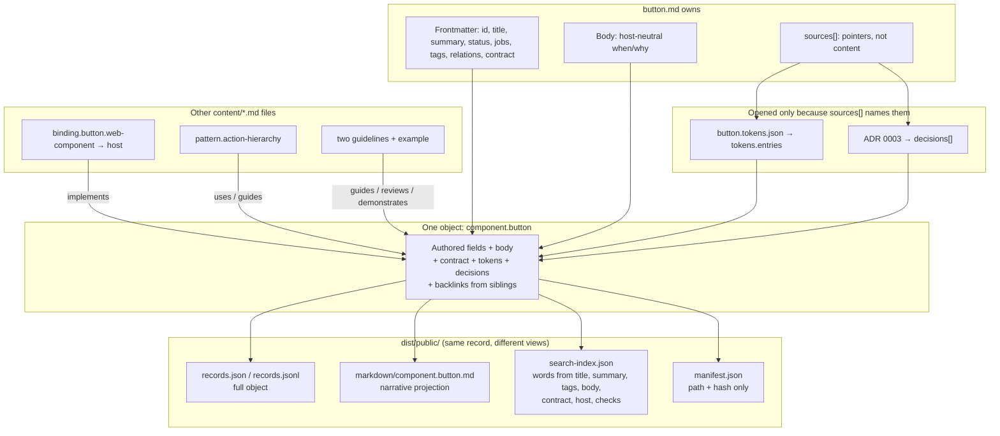

# Design system knowledge

This directory defines the requirements and content model for agent-facing Ember & Sage knowledge.
The knowledge system is independent of any one agent product or delivery protocol.

## Status

The knowledge package parses authored Markdown records and compiles them into public and internal
bundles. `pnpm --filter @stevegreco/design-system-knowledge build` writes `dist/public` and
`dist/internal`. The published package includes `dist/public` and `src` only.

`openCatalog` from `@stevegreco/design-system-knowledge/retrieve` answers `search`, `get`, `list`,
and `related` against one compiled bundle (KNOW-015). The documentation site consumes the Button
slice through that interface (KNOW-004). Tests cover schema validation, visibility isolation,
relationship integrity, deterministic compiler output, and the retrieval interface (KNOW-025). MCP
adapters are not implemented (KNOW-028).

## Reading order

1. [Requirements](requirements.md) defines the users, required behavior, first release, and
   non-goals.
2. [Content model](content-model.md) defines the records that make knowledge portable and
   retrievable.
3. [ADR 0003](../adr/0003-component-owned-portable-contracts.md) records that portable contracts
   are authored on component records. [ADR 0002](../adr/0002-knowledge-owned-portable-contracts.md)
   remains the host-neutrality decision. [ADR 0001](../adr/0001-portable-design-system-knowledge.md)
   is superseded.

## Accepted proposals

- [RFC 0001: Component contract record shape](../rfcs/0001-component-contract-record-shape.md)
  accepted Option B. Portable contracts live on component records. Host bindings stay separate.

Existing domain decisions remain authoritative:

- [Theming policy](../../packages/tokens/docs/adr/0002-theming-policy.md)
- [Token tier consumption](../../packages/tokens/docs/adr/0003-token-tier-consumption.md)

## How one record compiles

`packages/knowledge/src` is the compiler program. It is not an input. Authored Markdown under
`packages/knowledge/content/` is the input. Extra files are included only when a record lists them
in `sources[]`.

Button and Badge are the first-slice records that do that. Button also names
`button.tokens.json`. Badge omits token-source because it has no component-token namespace. The
portable contract is authored on the component record. The web-component mapping is a
`type: binding` record.
The other Markdown files compile as authored narrative plus their own frontmatter.

The compiled Markdown file is the narrative projection of that record. It is not a second copy of
the record. `openCatalog().get(id)` owns structured fields including `contract`, `host`, and
`checks`.

The other Markdown files are siblings, not outputs of `button.md`. They attach through relation
IDs. After the corpus exists, Button gains `backlinks.usedBy`, `backlinks.guidedBy`, and
`backlinks.reviewedBy`. Their
bodies are not copied into Button. The diagram traces Button. Badge follows the same path without
a token-source. Button and Badge point at each other with `related`.

`dist/internal/` uses the same layout. Today it holds the same public records as `dist/public/`. An
extra internal root would add records there only.

## Retrieval

Import `openCatalog` from `@stevegreco/design-system-knowledge/retrieve`. It reads `records.json`,
`search-index.json`, and `manifest.json` from one projected bundle. It does not parse Markdown or
call `compile`.

`openCatalog()` with no argument loads this package's `dist/public`. Pass a directory path or file
URL to open another bundle. Pass `{ records, searchIndex, manifest }` to open already-parsed JSON.
Directory opens verify SHA-256 and byte length for `records.json` and `search-index.json` against
`manifest.content.files`. They also read `manifest.content.visibility` instead of inferring it
from record contents. In-memory opens skip the file-hash check.

`get` returns the compiled record or `undefined`. `list` filters `type`, `status`, `visibility`,
`jobs`, and `tags`. `search` uses the compiled index and the same tokenizer the compiler used.
The index also tokenizes type-specific facts from `contract`, `host`, and `checks`. It does not
index `id`, `type`, or `jobs`.
`related` returns each neighbor once, with `via` edges named by the forward relation (KNOW-015).

## First content slice

The executable schema, authored Markdown parser, and knowledge compiler validate these draft
records:

- [Button](../../packages/knowledge/content/components/button.md)
- [Button web-component binding](../../packages/knowledge/content/bindings/button.web-component.md)
- [Badge](../../packages/knowledge/content/components/badge.md)
- [Badge web-component binding](../../packages/knowledge/content/bindings/badge.web-component.md)
- [Action hierarchy](../../packages/knowledge/content/patterns/action-hierarchy.md)
- [Button implementation](../../packages/knowledge/content/guidelines/button-implementation.md)
- [Button review](../../packages/knowledge/content/guidelines/button-review.md)
- [Settings action hierarchy example](../../packages/knowledge/content/examples/action-hierarchy-settings.md)

## Working agreement

- Keep durable requirements and decisions in this repository.
- Use stable requirement IDs when discussing or implementing behavior.
- Use issues to assign and track implementation work. Link each issue to the requirements it
  implements.
- Change these documents in the same pull request when implementation changes an accepted
  requirement or decision.
- Do not make an MCP server, documentation site, or agent skill the sole source of knowledge.
