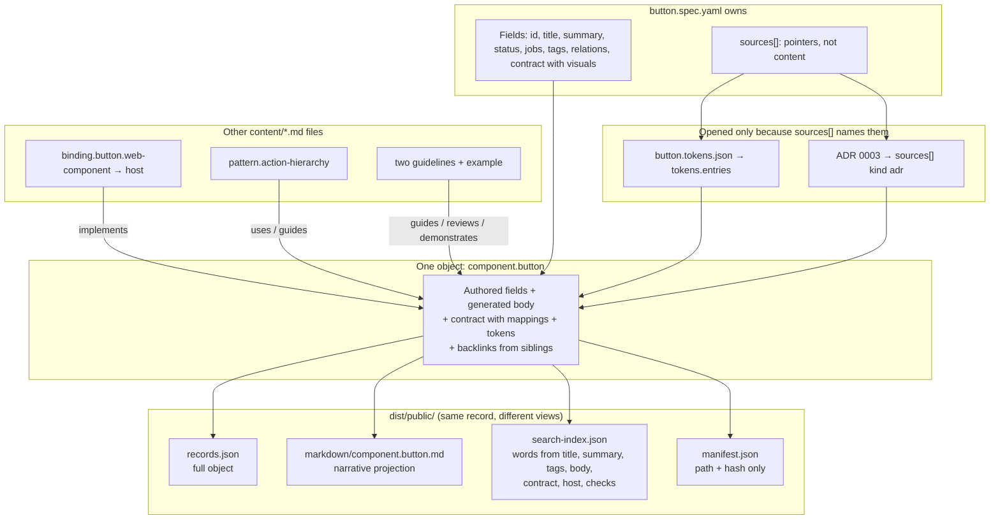

# Design system knowledge

This directory defines the requirements and content model for Ember & Sage knowledge. The
knowledge system is independent of any one agent product or delivery protocol.

To edit knowledge, start with the [package README](../../packages/knowledge/README.md). It says
which file to change, how to check it, and defines the terms used here.

## Status

The knowledge package parses authored Markdown records and YAML component specs and compiles them
into a public bundle.
`pnpm exec turbo run build --filter=@stevegreco/design-system-knowledge` writes `dist/public`. An internal bundle
is written only when internal content is configured. The published package includes `dist/public`
and `src` only.

`openCatalog` from `@stevegreco/design-system-knowledge/retrieve` answers `search`, `get`, `list`,
and `related` against one compiled bundle (KNOW-015). The documentation site renders every component
page through that interface (KNOW-004). Tests cover schema validation, visibility isolation,
relationship integrity, deterministic compiler output, and the retrieval interface (KNOW-025). MCP
adapters are not implemented (KNOW-028).

Format changes are listed in the package [CHANGELOG](../../packages/knowledge/CHANGELOG.md).

## Reading order

1. [Requirements](requirements.md) defines the users, required behavior, first release, and
   non-goals.
2. [Content model](content-model.md) defines the records that make knowledge portable and
   retrievable.
3. [ADR 0005](../adr/0005-yaml-component-specs.md) records YAML component specs and generated
   narrative. [ADR 0003](../adr/0003-component-owned-portable-contracts.md) remains the
   component-ownership decision. [ADR 0004](../adr/0004-compact-visual-authoring.md) records
   compact visual authoring and state resolution. [ADR 0002](../adr/0002-knowledge-owned-portable-contracts.md)
   remains the host-neutrality decision. [ADR 0006](../adr/0006-okf-alignment.md) records which
   Open Knowledge Format principles the catalog shares. [ADR 0001](../adr/0001-portable-design-system-knowledge.md)
   is superseded.
4. [New component definition of done](new-component.md) lists the build path, the states and
   options each component must decide on, and the checks that prove the contract.

## Accepted proposals

- [RFC 0001: Component contract record shape](../rfcs/0001-component-contract-record-shape.md)
  accepted Option B. Portable contracts live on component records. Host bindings stay separate.
- [ADR 0004: Compact visual authoring](../adr/0004-compact-visual-authoring.md) compiles grouped
  `visuals` into mapping rows and records simultaneous-state resolution.

Existing domain decisions remain authoritative:

- [Theming policy](../../packages/tokens/docs/adr/0002-theming-policy.md)
- [Token tier consumption](../../packages/tokens/docs/adr/0003-token-tier-consumption.md)

## Reviews and planned work

- [Knowledge layer simplification plan, 2026-09-28](simplification-plan.md) is the current plan.
  It replaces the open items in the architecture review below.
- [Architecture review and agent handoff, 2026-09-04](architecture-review-2026-09-04.md) records
  simplification proposals, evidence, requirement impacts, and verification steps. It does not
  supersede accepted requirements or decisions.

## How one record compiles

`packages/knowledge/src` is the compiler program. It is not an input. Authored Markdown and
`*.spec.yaml` files under
`packages/knowledge/content/` are the input. Extra files are included only when a record lists them
in `sources[]`.

Component records do that. Button also names `button.tokens.json` because it publishes a
component-token namespace. A component without one, such as Badge, omits token-source. The
portable contract is authored on the YAML component record. The web-component mapping is a
`type: binding` record.
The other Markdown files compile as authored narrative plus their own frontmatter.

The compiled Markdown file is the narrative projection of that record. It is not a second copy of
the record. `openCatalog().get(id)` owns structured fields including `contract`, `host`, and
`checks`.

The other Markdown files are siblings, not outputs of `button.spec.yaml`. They attach through relation
IDs. After the corpus exists, Button gains `backlinks.usedBy`, `backlinks.guidedBy`, and
`backlinks.reviewedBy`. Their
bodies are not copied into Button. The diagram traces Button. Badge follows the same path without
a token-source. Button and Badge point at each other with `related`.

An internal bundle, `dist/internal/`, uses the same layout. The build writes it only when an
internal content root is configured. None is today.

## Retrieval

Import `openCatalog` from `@stevegreco/design-system-knowledge/retrieve`. It reads `records.json`,
`search-index.json`, and `manifest.json` from one projected bundle. It does not parse Markdown or
call `compile`.

`openCatalog()` with no argument loads this package's `dist/public`. Pass a directory path or file
URL to open another bundle. Pass `{ records, searchIndex, manifest }` to open already-parsed JSON.
Directory opens verify SHA-256 and byte length for `records.json` and `search-index.json` against
`manifest.content.files`. They also read `manifest.content.visibility` instead of inferring it
from record contents. In-memory opens skip the file-hash check.

`get` returns the compiled record or `undefined`. `list` filters `type`, `status`, `visibility`,
`jobs`, and `tags`. `search` uses the compiled index and the same tokenizer the compiler used.
The index also tokenizes type-specific facts from `contract`, `host`, and `checks`. It does not
index `id`, `type`, or `jobs`.
`related` returns each neighbor once, with `via` edges named by the forward relation (KNOW-015).

## First content slice

The executable schema, authored Markdown parser, and knowledge compiler validate every record under
[`packages/knowledge/content/`](../../packages/knowledge/content/):

- [`components/`](../../packages/knowledge/content/components/) holds one `<name>/<name>.spec.yaml` per component.
- [`bindings/`](../../packages/knowledge/content/bindings/) holds host bindings such as `<name>.web-component.md`.
- [`guidelines/`](../../packages/knowledge/content/guidelines/), [`patterns/`](../../packages/knowledge/content/patterns/), and [`examples/`](../../packages/knowledge/content/examples/) hold the narrative records.

## Working agreement

- Keep durable requirements and decisions in this repository.
- Use stable requirement IDs when discussing or implementing behavior.
- Use issues to assign and track implementation work. Link each issue to the requirements it
  implements.
- Change these documents in the same pull request when implementation changes an accepted
  requirement or decision.
- Do not make an MCP server, documentation site, or agent skill the sole source of knowledge.
- Visual change workflow: accept the design intent; edit compact `visuals` and token sources as
  needed; update CSS and Figma; run knowledge compile and the component mapping tests; release
  token, knowledge, and component packages together when the published contract or CSS references
  change. Token-value-only changes normally need no mapping or CSS-reference edits. Figma
  agreement is manual until an adapter exists.
