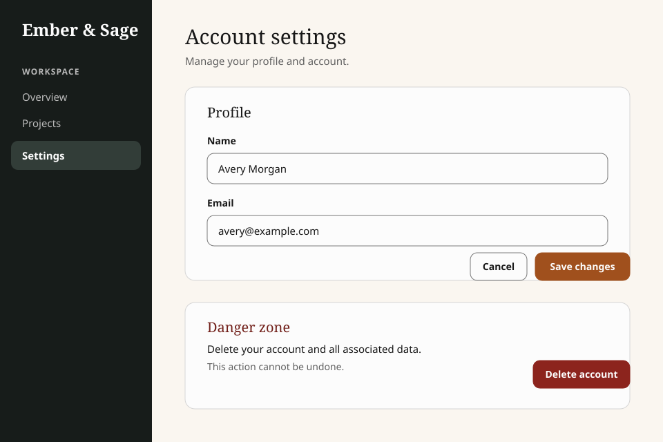

This account settings screen contains two independent action groups.

The profile form pairs a secondary "Cancel" action with one primary "Save changes" action. The
primary action completes the routine editing task.

Account deletion is destructive and operates on a different subject. A labeled danger zone
separates it from the profile form. Its supporting text explains the consequence before the person
reaches the danger Button.

## What this example demonstrates

- Hierarchy applies within an action group rather than across the whole page.
- A supporting action remains visible without competing with the primary path.
- A destructive action is separated from routine actions.
- Button labels name their results.
- Text and structure communicate purpose and risk without relying on color.

## What this example does not decide

The example does not define universal button ordering. Products must follow their established
reading direction and platform convention while preserving the semantic hierarchy.
