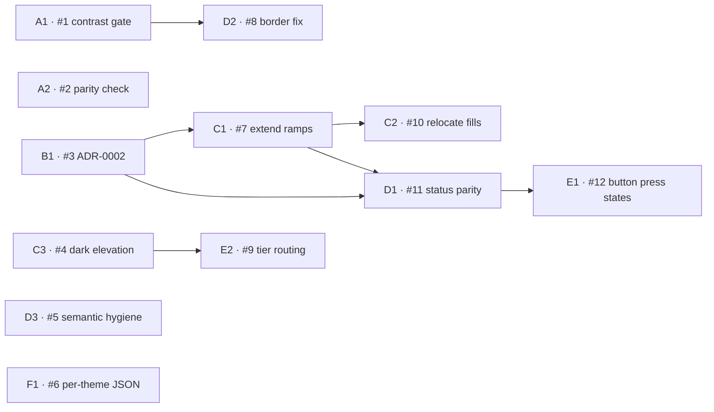

# Token Remediation Plan

Work breakdown for the findings in [token-architecture-audit.md](./token-architecture-audit.md).

> Historical plan: the full status-interaction parity described in D1 was later narrowed. Only
> danger retains interactive roles because it has a shipped consumer; see ADR-0002.

## How this is split

Four rules govern the decomposition:

1. **One item, one PR.** Each item is independently reviewable and revertable. Nothing here requires two items to land together to leave the repo in a working state.
2. **Additive and breaking changes are separated.** They carry different release semantics, so an item never mixes "adds new tokens" with "changes what an existing token resolves to."
3. **Guardrails land before the work they guard.** The contrast and parity checks are additive and touch no token values, so they can ship immediately — and then verify the remediation that follows.
4. **The one decision is isolated.** `B1` is the only item requiring a design judgement. Everything downstream is mechanical once it exists, so it is kept small and blocking rather than bundled into a code change.

## Items

| ID | Issue | Item | Fixes | Size | Breaking | Depends on |
|---|---|---|---|---|---|---|
| **A1** | #1 | Contrast audit script + build gate | TOK-07 | M | no | — |
| **A2** | #2 | Theme parity check | TOK-01 | S | no | — |
| **B1** | #3 | ADR-0002: theming policy | TOK-01, TOK-02 | S | no | — |
| **C1** | #7 | Extend `rust`/`moss`/`sky` to full scale | TOK-03 | M | no | #3 |
| **C2** | #10 | Relocate surface fills out of hue ramps | TOK-04 | M | **yes** | #7 |
| **C3** | #4 | Dark elevation primitives + semantic tier | TOK-05 | M | no | — |
| **D1** | #11 | Status interactive contract parity | TOK-01, TOK-02, TOK-10 | L | **yes** | #3, #7 |
| **D2** | #8 | `border.default` contrast remediation | TOK-07 | S | **yes** | #1 |
| **D3** | #5 | Semantic hygiene: dedupe + dead token | TOK-08, TOK-09 | S | **yes** | — |
| **E1** | #12 | Button state parity | TOK-11 | S | no | #11 |
| **E2** | #9 | Route components through semantic tier | TOK-05, TOK-12 | S | **yes** | #4 |
| **F1** | #6 | Per-theme component JSON + MCP fix | TOK-06 | M | no | — |

`A1`, `A2`, `B1`, `C3`, `D3` and `F1` have no blockers and can start in parallel.

---

## Track A — Guardrails

Additive, no token values change. Ship first so the remediation is verified by the same checks that will guard it afterward.

### A1 — Contrast audit script + build gate

Extract the audit's contrast script into `scripts/audit-contrast.js`. Compute WCAG 2.1 ratios for every semantic foreground/background pair in both themes, fail the build on any pair below its requirement.

**Acceptance**
- Runs over both themes from `dist/tokens/semantic.*.json`
- Distinguishes 4.5:1 text pairs from 3:1 non-text pairs
- Exits non-zero on failure with the offending pair, both hex values, and the actual ratio
- Wired into `pnpm build`; documented in `CONTEXT.md`
- Currently fails on TOK-07 — that is expected and is what `D2` clears

### A2 — Theme parity check

Assert the two themes are structurally equivalent.

**Acceptance**
- Fails if light and dark define different token key sets
- Fails if a token's L\* moves in one theme's ramp direction but not the other's — the assertion that makes TOK-01 unrepeatable
- Runs in the same script pass as `A1`

---

## Track B — Decision

### B1 — ADR-0002: theming policy

No code. Write the policy the system already half-follows, as `docs/adr/0002-theming-policy.md`, matching ADR-0001's Status/Context/Decision/Consequences format.

**Decisions to record**

1. **Mirrored ramps.** Accent *and* status both invert lightness across themes. This is already accent's behaviour and what the dark theme is visually designed around; abandoning it would surrender the 8.36:1 primary contrast dark mode currently earns. The defect is status being left behind, not the flip itself.
2. **Interaction-state direction.** In light themes, hover and press step toward the darker end of the ramp; in dark themes, toward the lighter end.
3. **Ramp integrity.** A numbered stop in a hue ramp holds that ramp's hue within ~2° and saturation within ~5 points. Surfaces are not ramp stops.

**Acceptance** — merged ADR; `C1`, `C2` and `D1` cite it.

---

## Track C — Primitives

### C1 — Extend `rust`, `moss`, `sky` to full scale

Additive only. Fill each to `50, 100, 200, 300, 400, 500, 600, 700, 800, 900, 950`, holding hue within ~2° and saturation within ~5 points across the ramp, matching how `robRoy` behaves through its true stops. Existing `100/500/700` values are anchors and must not move.

**Acceptance**
- Each ramp monotonic in L\* with roughly even spacing
- `A2` passes
- No existing resolved value changes — diff `dist/` to confirm

### C2 — Relocate surface fills out of hue ramps

**Breaking.** Move `rust.900`, `moss.900`, `sky.900`, `robRoy.850` and `robRoy.925` into a separate `primitives.surface.*` group and regenerate honest terminal stops in their place. Update the semantic tokens that reference them.

**Acceptance**
- No stop in any hue ramp deviates >2° hue / >5 points saturation from its neighbours
- Dark-theme status backgrounds render unchanged (they now resolve via `primitives.surface.*`)
- Changed paths listed in the changeset

### C3 — Dark elevation primitives + semantic tier

Add a dark shadow set built on a near-black at higher opacity. Introduce `semantic.elevation.{xs,sm,md,lg,xl,inset}` resolving to the warm set in light and the new set in dark. Existing `primitives.shadow.*` stay untouched.

**Acceptance**
- Elevation is perceptible on `background.raised` in both themes
- `semantic.elevation.*` defined in both theme files with identical keys
- Purely additive — no component references change here (that is `E2`)

---

## Track D — Semantic

### D1 — Status interactive contract parity

**Breaking.** The item that actually fixes the buttons. Give all four statuses the full contract — `default`, `hover`, `press`, `onDefault`, `foreground`, `background` — in both themes, following `B1`'s direction rule.

**Acceptance**
- All four statuses expose identical key sets in both themes
- Dark-theme `status.*.default` inverts lightness relative to light, as accent does
- Hover/press step toward the light end in dark and the dark end in light — for every status, no exceptions
- `status.danger.default` clears 3:1 against the dark page background (currently 3.26)
- `A1` and `A2` pass
- Visual check: primary and danger buttons read as siblings in dark mode

### D2 — `border.default` contrast remediation

**Breaking.** Raise `border.default` to clear 3:1 against its own theme's page — roughly `blueSmoke.300` light, `blueSmoke.600` dark. Preserve today's values as `border.subtle` for decorative dividers where the 3:1 rule does not apply. Audit existing `border.default` consumers and move purely decorative ones to `border.subtle`.

**Acceptance** — `A1` passes; input boundaries visible in both themes.

### D3 — Semantic hygiene

**Breaking** (removes public tokens). Delete `foreground.onAccent`, keep `accent.foreground`, update `examples/dashboard.css:721`. Delete `secondary.hover` or give it a consumer — do not ship it undecided.

**Acceptance** — no duplicate-value token pairs; every semantic token has ≥1 consumer or a documented reason to exist.

---

## Track E — Components

### E1 — Button state parity

Add a distinct `backgroundPress` to secondary, ghost and danger, using the `status.*.press` and `secondary.press` tokens `D1` introduces.

**Acceptance** — all four variants define rest/hover/press/disabled; no variant's press equals its hover.

### E2 — Route components through the semantic tier

**Breaking** (changes resolved values). Point `input.radius` at `semantic.radius.control`, and card/input shadows at `semantic.elevation.*`. Components should reach the primitive tier for nothing that has a semantic equivalent.

**Acceptance**
- Input and button corner radii match
- No component references `primitives.shadow.*` or `primitives.radius.*` where a semantic token exists
- Cards show elevation in dark mode

---

## Track F — Pipeline

### F1 — Per-theme component JSON + MCP fix

Additive. **The CSS platform is already correct and must not change** — `outputReferences` is what carries theming through the component tier. Split only the JSON platform.

**Acceptance**
- `componentsJsonConfig(theme)` mirrors `semanticConfig(theme)`, emitting `components.light.json` and `components.dark.json`
- `dist/css/tokens.css` byte-identical before and after
- `loadTokens(theme)` loads the matching component file
- `package.json` exports the new per-theme entries
- Regression test: `loadTokens('dark')` returns `component.button.primary.background === semantic.color.accent.default` — the assertion that currently fails
- `CONTEXT.md` Token Result example updated to show theme-dependent values

---

## Release sequencing

| Release | Items | Rationale |
|---|---|---|
| Patch, immediately | A1, A2, B1, F1 | Additive or docs-only. Lands the guardrails and the policy before anything they govern. |
| Minor | C1, C2, C3, D1, D2, D3, E1, E2 | These change published token values and must ship together — a consumer picking up extended ramps without the semantic changes gets new primitives nothing references. |

`A1` will fail the build until `D2` lands. Either land `A1` in report-only mode and flip it to blocking with `D2`, or accept a known-failing gate on a branch for the duration of the minor.
